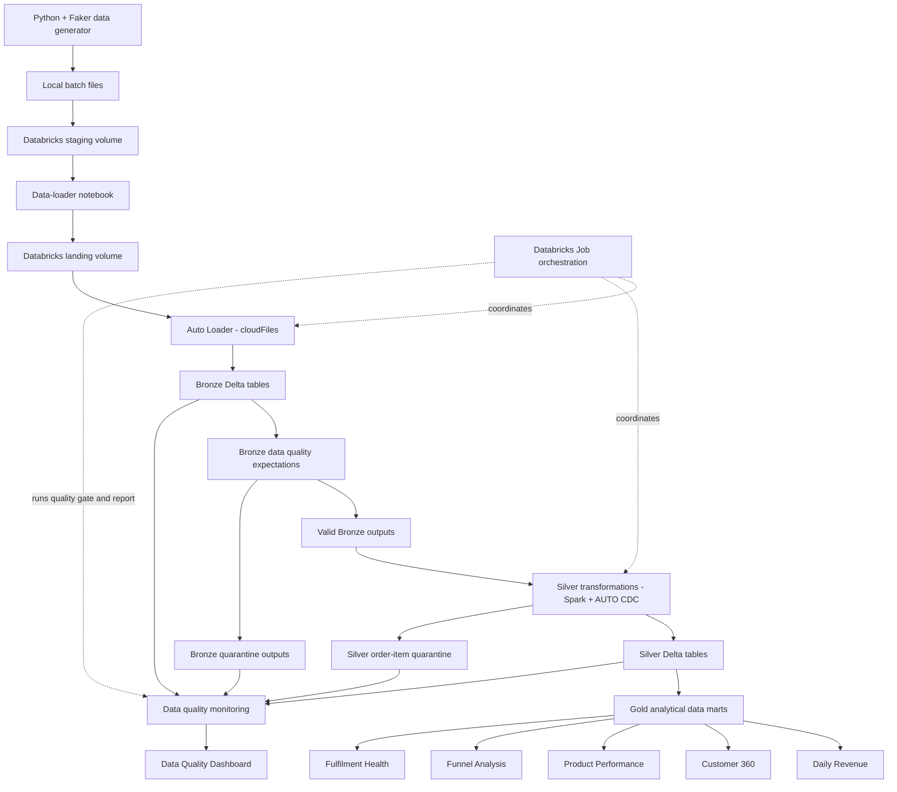

# ForwardStep – Cloud Data Lakehouse

**Cloud Data Engineering | Databricks | Apache Spark | Delta Lake | Medallion Architecture | Data Quality | CI/CD**

ForwardStep is an end-to-end cloud data engineering project that builds a Databricks Lakehouse for a simulated online footwear retailer. It brings together operational, product, inventory and website-interaction data and turns it into validated, analytics-ready datasets for business reporting.

The implementation covers the complete data engineering lifecycle: synthetic data generation, incremental ingestion, CDC processing, historical data management, analytical modelling, data quality monitoring, workflow orchestration, automated testing and multi-environment deployment.

## Project at a Glance

- **Business scenario:** Mid-sized online footwear retailer representing approximately 5,000 customers, 20,000 annual orders, 500 products across 6 categories and 3 warehouses.
- **Data sources:** 7 interconnected datasets in CDC-format JSON, JSON and CSV.
- **Architecture:** Databricks Medallion Architecture with Bronze, Silver and Gold layers.
- **Ingestion:** Databricks Auto Loader with explicitly defined PySpark schemas.
- **Transformations:** Apache Spark, Delta Lake and Databricks AUTO CDC.
- **Analytics:** 5 Gold-layer data marts for revenue, customer insights, product performance, marketing conversion and fulfilment health.
- **Data quality:** Row-level expectations, quarantine outputs, business-rule validation, 8 referential-integrity checks and job-level quality gates.
- **Delivery:** Databricks Jobs, PyTest, the Databricks SDK, GitHub Actions and Declarative Automation Bundles (DABs).

## Business Scenario

The retailer's data is distributed across transactional systems, product and inventory files, and website event records. Without a unified data platform, teams depend on manual extracts and spreadsheet consolidation, resulting in reporting delays and inconsistent figures.

ForwardStep addresses five reporting needs:

| Business area | Reporting need | Gold-layer output |
|---|---|---|
| Finance | Analyse gross revenue, discounts and net revenue by date, category and region. | `gold_daily_revenue` |
| Marketing | Combine current customer profiles with purchase history and customer-level metrics. | `gold_customer_360` |
| Merchandising | Compare product sales performance with the latest inventory across warehouses. | `gold_product_performance` |
| Growth | Analyse session-level website conversion by marketing referrer, including anonymous sessions. | `gold_funnel_analysis` |
| Operations | Monitor delivery performance against a five-day SLA by order date and region. | `gold_fulfillment_health` |

## Architecture

The platform follows a Medallion Architecture. Synthetic source files are generated locally, transferred through Databricks-managed staging and landing volumes, and incrementally ingested into Bronze. Validated Bronze data is transformed in Silver and used to produce the Gold analytical data marts.



### Source datasets

The initial generated dataset represents approximately one year of order and website-interaction history, together with 30 days of inventory snapshots across three warehouses.

| Source | Input format | Approximate initial records | Ingestion pattern |
|---|---|---:|---|
| Customers | CDC-format JSON | 5,000 | CDC |
| Orders | CDC-format JSON | 20,000 | CDC |
| Order Items | CDC-format JSON | 38,000 | CDC |
| Products | CSV | 500 | File-based |
| Categories | CSV | 6 | File-based |
| Clickstream | JSON | 180,000 | File-based |
| Inventory | CSV | 45,000 | File-based |

A Python data generator built with Faker produces both the initial dataset and subsequent incremental batches. Later batches can contain new entities and updates to existing customers, orders and products, as well as new clickstream events and inventory snapshots. Generator state maintains identifiers and relationships between batches.

## Medallion Lakehouse Implementation

### Bronze – Incremental Ingestion

The Bronze ingestion pipeline uses **Databricks Auto Loader (`cloudFiles`)** to discover and process incoming files from the landing volume. Each of the seven sources has an explicitly declared PySpark schema rather than relying on schema inference.

For customers, orders and order items, the original CDC envelope is retained in Bronze, including:

- `op` – change operation type.
- `ts_ms` – source event timestamp.
- `before` – record state before the change.
- `after` – record state after the change.

File-based records are ingested in their source structure. All Bronze datasets also receive ingestion metadata:

- `_ingested_at` – timestamp when the record was ingested.
- `_source_file` – source file path from Databricks file metadata.

Bronze quality checks classify records into valid and quarantined outputs. The raw ingestion layer is retained, while downstream Silver transformations consume the validated `*_valid` tables.

### Silver – Conformance and Change Processing

The Silver pipeline uses **Apache Spark, Delta Lake and Databricks AUTO CDC** to flatten CDC envelopes, standardise data types, apply business rules and manage changing records according to each source's requirements.

| Source | Processing strategy | Purpose |
|---|---|---|
| Orders | SCD Type 2 | Preserve order-status history. |
| Customers | SCD Type 2 | Preserve customer-profile and loyalty-tier history. |
| Order Items | SCD Type 1 | Maintain the latest version of each order item. |
| Products | SCD Type 1 | Maintain the latest product attributes. |
| Categories | SCD Type 1 | Maintain the latest category attributes. |
| Clickstream | Append-only | Retain individual website-interaction events. |
| Inventory | Append-only | Preserve historical inventory snapshots. |

For SCD Type 2 datasets, current records are identified using the `__END_AT` field maintained by the CDC processing framework. Historical versions remain available for temporal analysis.

Silver expectations monitor business rules such as accepted order statuses, valid loyalty tiers, product pricing constraints and inventory consistency. Most of these checks are report-only. Order items have an additional financial validation: records are accepted when the difference between `line_total` and `quantity × unit_price` is less than `0.01`. Records that fail this check are written to `silver_order_items_quarantined`; only validated order items are used in downstream revenue calculations.

### Gold – Analytical Data Marts

The Gold layer produces five business-oriented analytical outputs from the Silver datasets.

| Data mart | Source datasets | Grain | Main metrics and logic |
|---|---|---|---|
| `gold_daily_revenue` | Orders, order items, products, categories | Date, category and region | Gross revenue, proportionally allocated order discounts and net revenue. Current SCD Type 2 order records are used. |
| `gold_customer_360` | Customers, orders | One row per customer | Lifetime value, order count, last order date and days since last order. This is descriptive customer analytics, not a predictive churn model. |
| `gold_product_performance` | Order items, products, inventory | One row per product | Units sold, revenue and latest inventory across product/warehouse combinations. Products with current stock below 20 units are flagged as stockout risks. |
| `gold_funnel_analysis` | Clickstream | Marketing referrer | Total sessions, sessions containing a purchase event and conversion rate. Conversion is attributed at session level, so anonymous sessions are included. |
| `gold_fulfillment_health` | Orders | Order date and region | Delivered orders, orders delivered within five days and the resulting SLA compliance rate. |

The marts separate business reporting logic from operational source structures, reducing the need for downstream users to repeatedly reconstruct the same joins and calculations.

## Data Quality and Monitoring

Data quality is handled at multiple stages rather than as a single final validation step.

### Bronze expectations and quarantine

The ingestion pipeline applies Databricks `@dp.expect_all` expectations to all seven sources. Checks cover required identifiers and fields, accepted values and basic numeric constraints. Records failing one or more expectations are flagged and routed to source-specific quarantine outputs instead of being silently discarded.

### Silver business rules

Silver expectations monitor source-specific rules, including order status, customer attributes, product pricing, clickstream references and inventory consistency. Most Silver expectations are report-only. The order-item line-total rule is quarantined because an incorrect value could distort revenue reporting.

### Referential integrity

Eight SQL anti-join checks monitor relationships across the Silver datasets:

1. Orders to customers.
2. Order items to orders.
3. Order items to products.
4. Products to categories.
5. Inventory to products.
6. Clickstream to products.
7. Clickstream to customers.
8. Clickstream to orders.

For SCD Type 2 parent tables, checks use the current record (`__END_AT IS NULL`). Nullable clickstream references are checked only when a value is present.

### Data Quality Dashboard and event hooks

The Databricks Data Quality Dashboard is backed by three SQL views:

- `dq_expectations_history`
- `dq_quarantine_counts`
- `dq_referential_integrity`

The dashboard presents expectation results, quarantine volumes and referential-integrity findings. Pipeline event hooks listen for `flow_progress` events and generate an alert message when an expectation's failure rate exceeds a configurable 25% threshold. The current `send_alert()` implementation prints the message; it is not connected to an external notification service.

### Job-level quality gate

The `dq_check` notebook task runs after ingestion and before Silver transformation. It checks that:

- Every one of the seven Bronze tables contains at least one record ingested on the current run date.
- The quarantine rate for each Bronze source does not exceed 50% for records ingested on that date.

If either condition fails, the task raises an exception and blocks the downstream transformation task.

## Workflow Orchestration

The `forwardstep-orchestration-job` coordinates the end-to-end workflow through four dependent tasks:

| Task | Execution type | Responsibility |
|---|---|---|
| `run_ingestion` | Databricks Pipeline Task | Runs Bronze ingestion and produces raw, valid and quarantined Bronze tables. |
| `dq_check` | Notebook Task | Checks ingestion completeness and quarantine rates for the current run. |
| `run_transformation` | Databricks Pipeline Task | Runs Silver transformations and produces the Gold analytical outputs. |
| `report` | Spark Python Task | Runs `jobs/report.py` to summarise Bronze, Silver and Gold record counts and quarantine statistics. |

The job uses a `run_date` parameter that defaults to the Databricks job start date (`{{job.start_time.iso_date}}`). The target catalog is configured through the deployment bundle. The reporting task receives its parameters as command-line arguments, while the quality-check notebook uses Databricks notebook widgets.

## Testing Strategy

The project includes unit, integration and production smoke tests.

### Unit tests

- **Ingestion:** Two PyTest cases validate the `quarantine_rule()` utility, including the combination of multiple rules and handling of an empty rules dictionary.
- **Transformations:** Six test cases cover the five Gold business-logic functions, including discount allocation, SCD Type 2 filtering, zero-subtotal handling, latest inventory selection, deterministic Customer 360 calculations, anonymous funnel sessions and the five-day fulfilment SLA boundary.
- **Spark testing:** Transformation tests use a local Spark fixture and compare expected and actual DataFrames with `assertDataFrameEqual`.

### UAT integration testing

An end-to-end integration test uses deterministic generated data and the Databricks SDK to exercise the deployed UAT pipelines and orchestration job. It clears the UAT landing area, uploads a controlled test batch, runs full refreshes of the ingestion and transformation pipelines, and triggers the orchestration job.

The test performs row-conservation and zero-quarantine checks for four Bronze sources: categories, customers, products and orders. It also asserts successful completion of the orchestration job.

### Production smoke tests

After deployment, non-destructive smoke tests check that the production pipelines, orchestration job and Data Quality Dashboard are accessible, that the latest pipeline updates have not failed or been cancelled when available, and that all five Gold outputs can be queried. Gold row counts are logged for inspection but are not treated as pass/fail conditions.

## CI/CD and Deployment

The project uses **GitHub Actions** and **Declarative Automation Bundles (DABs; formerly Databricks Asset Bundles)** to validate and deploy Databricks resources across development, UAT and production.

### Deployment environments

| Environment | Workspace | Unity Catalog catalog | Purpose |
|---|---|---|---|
| Development | Shared development/UAT workspace | `dev` | Development and pipeline implementation. |
| UAT | Shared development/UAT workspace | `uat` | Deployment validation and integration testing. |
| Production | Separate production workspace | `prod` | Production deployment and scheduled execution. |

Development and UAT use separate catalogs in the same workspace. Production is isolated in a separate Databricks workspace.

### Declarative Automation Bundles

The bundle configuration is maintained in `bundle/databricks.yml`. It defines the ingestion and transformation pipelines, orchestration job, Data Quality Dashboard and environment bootstrap job. Target-specific configuration determines the catalog, workspace and SQL warehouse settings.

For an authenticated Databricks CLI session and a configured target, bundle validation and deployment use:

```bash
databricks bundle validate --target dev
databricks bundle deploy --target dev
```

The target can be changed to `uat` or `prod` as appropriate. The production workflow also uses separate GitHub repository secrets for production workspace authentication.

### GitHub Actions workflows

**UAT – `.github/workflows/ci.yml`**

The UAT workflow is manually triggered through `workflow_dispatch` and runs three sequential stages:

1. Run the ingestion and transformation unit-test suites.
2. Validate and deploy the bundle to UAT, then execute the environment bootstrap job.
3. Run the end-to-end integration test against the deployed UAT resources.

**Production – `.github/workflows/deploy-prod.yml`**

Production deployment is manually triggered from the `main` branch and requires the exact confirmation phrase `DEPLOY PROD`. After confirmation, the workflow validates and deploys the production bundle, executes the environment bootstrap job and runs the production smoke tests.

### Environment bootstrap

The environment bootstrap job prepares a target environment through five tasks:

1. Create the target schema, landing volume and seven source-specific landing directories.
2. Run the ingestion pipeline to initialise Bronze tables.
3. Run the transformation pipeline to initialise Silver and Gold outputs.
4. Create separate event-log views for the ingestion and transformation pipelines.
5. Configure the Data Quality Dashboard.

The production catalog is created manually before the initial deployment. The recurring production schedule and job-failure notifications are also configured directly in the production Databricks workspace, separately from the bundle-managed resources.

## Repository Structure

The repository is organised around pipeline implementation, reusable job logic, monitoring resources, deployment configuration and CI/CD workflows.

```text
.
├── .github/
│   └── workflows/
│       ├── ci.yml
│       └── deploy-prod.yml
├── bundle/
│   ├── databricks.yml
│   └── resources/
├── jobs/
│   ├── dq_check/
│   └── report.py
├── monitoring/
│   ├── Data Quality Monitoring/
│   └── dq_dashboard_setup/
├── pipelines/
│   ├── ingestion_pipeline/
│   │   ├── tests/
│   │   ├── transformations/
│   │   └── utilities/
│   └── transformation_pipeline/
│       ├── tests/
│       ├── transformations/
│       └── utilities/
└── README.md
```

## Technology Stack

| Area | Technologies |
|---|---|
| Cloud data platform | Databricks, Unity Catalog, Databricks-managed volumes |
| Data ingestion | Databricks Auto Loader, PySpark schemas, JSON, CSV |
| Processing and storage | Apache Spark, PySpark, Spark SQL, Delta Lake, Databricks AUTO CDC |
| Data generation | Python, Faker |
| Data quality and monitoring | Databricks pipeline expectations, quarantine logic, SQL views, Data Quality Dashboard, pipeline event hooks |
| Orchestration | Databricks Jobs and Workflows, notebook tasks, Spark Python tasks |
| Testing | PyTest, PySpark testing utilities, `assertDataFrameEqual`, Databricks SDK for Python |
| CI/CD and deployment | Git, GitHub Actions, Databricks CLI, Declarative Automation Bundles (DABs), YAML |

## Data and Credentials

All retail records in this project are synthetic and generated for the footwear-retailer scenario; they are not real customer or transaction data. Workspace credentials and access tokens are supplied through the relevant Databricks authentication configuration and GitHub repository secrets rather than being stored in source files.
